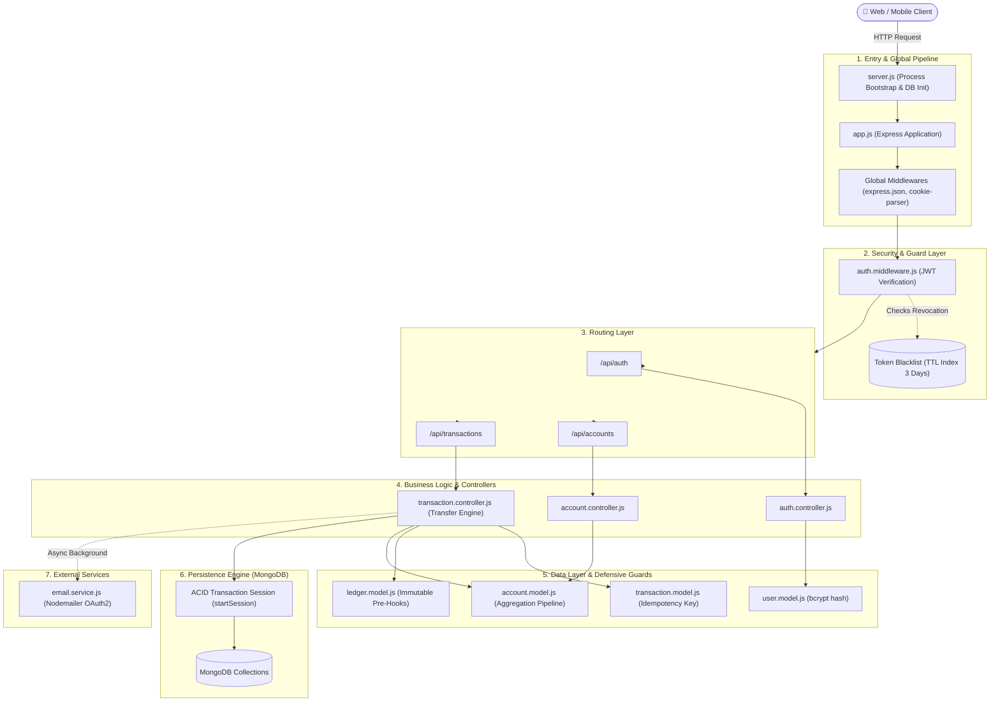
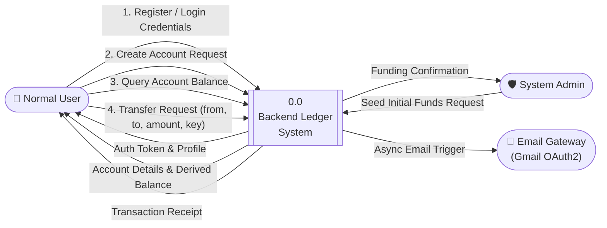
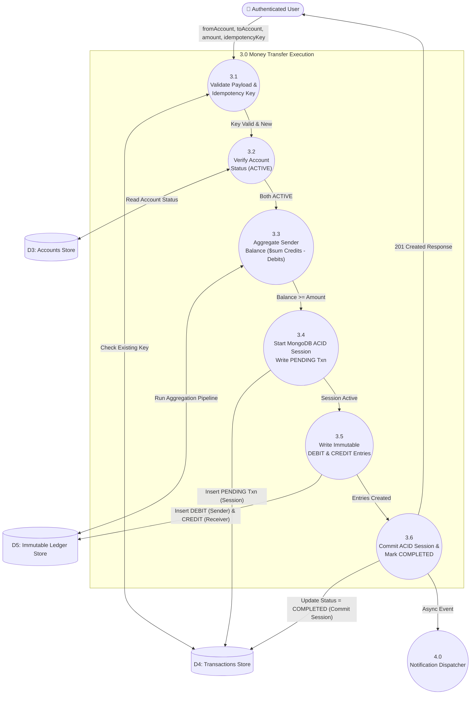
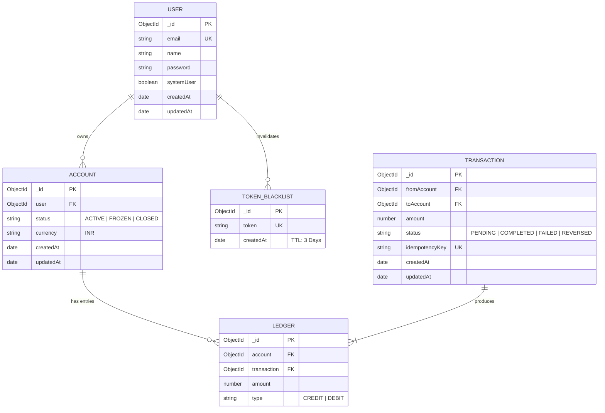
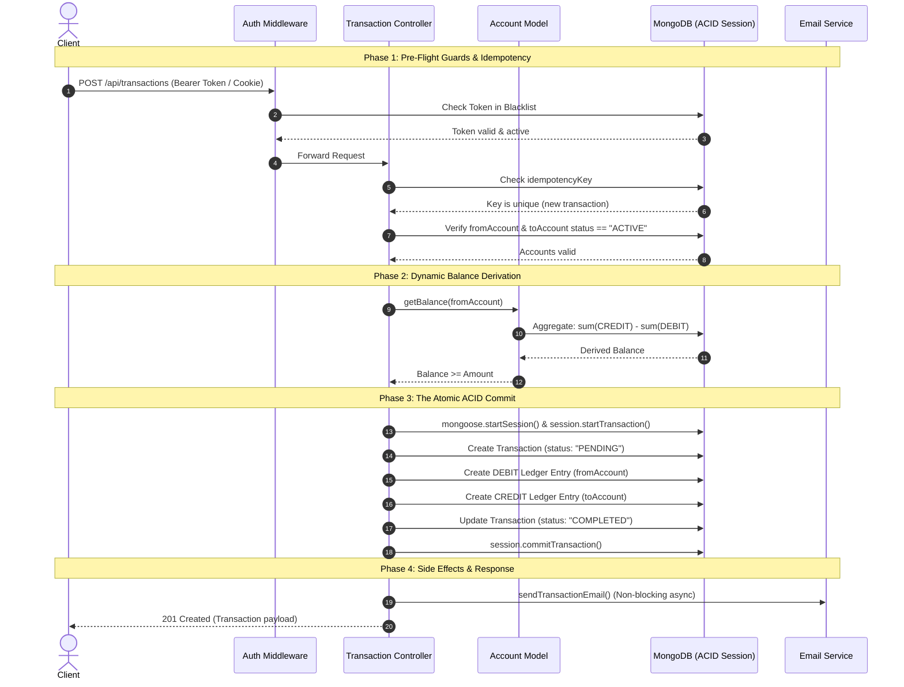

# 🏦 Backend Ledger — Double-Entry Financial Accounting & Transfer Engine

A high-reliability, double-entry financial accounting backend service built with **Node.js**, **Express.js**, and **MongoDB**. 

Designed around core fintech principles: **zero static balances**, **strict append-only ledger immutability**, **multi-document ACID transactions**, **request idempotency**, and **dynamic balance derivation via aggregation pipelines**.

---

## 📑 Table of Contents
- [Key Features](#-key-features)
- [System Architecture](#-system-architecture)
- [Data Flow Diagrams (DFD)](#-data-flow-diagrams-dfd)
  - [Level 0: Context Diagram](#level-0-context-diagram)
  - [Level 1: Subsystem Level](#level-1-subsystem-level)
  - [Level 2: Transaction Lifecycle](#level-2-transaction-lifecycle)
- [Entity-Relationship Diagram (ERD)](#-entity-relationship-diagram-erd)
- [The 4-Phase Transfer Lifecycle](#-the-4-phase-transfer-lifecycle)
- [Core Architectural Decisions](#-core-architectural-decisions)
- [API Reference](#-api-reference)
- [Getting Started](#-getting-started)
- [Environment Configuration](#-environment-configuration)

---

## ⚡ Key Features

- **Double-Entry Bookkeeping:** Every transaction produces equal and offsetting `DEBIT` and `CREDIT` entries. Money is never created or destroyed arbitrarily.
- **Zero Mutable Balances:** Account balances are not stored as static numbers. Balances are dynamically calculated using MongoDB aggregation pipelines (`$group`, `$cond`, `$subtract`) over immutable ledger entries.
- **Driver-Level Immutability:** Mongoose pre-query hooks intercept and reject any `updateOne`, `deleteOne`, `findOneAndUpdate`, or `deleteMany` operations on the ledger collection.
- **ACID Multi-Document Transactions:** Money transfers execute inside isolated MongoDB sessions (`mongoose.startSession()`), guaranteeing atomicity across multi-collection writes.
- **Request Idempotency:** Client-supplied unique `idempotencyKey` prevents duplicate transactions during network retries and double-clicks.
- **Stateful JWT Session Revocation with 3-Day TTL:** Logged-out tokens are stored in a MongoDB blacklist with an automated **3-day TTL index** (`expireAfterSeconds: 259200`), eliminating database bloat without external cron jobs.
- **Role-Based Access Control (RBAC):** Restricts system-level initial fund seeding (`/api/transactions/system/initial-funds`) to authenticated `systemUser` accounts.
- **Asynchronous Notifications:** Non-blocking email alerts dispatched via Nodemailer with Google OAuth2.

---

## 🏛️ System Architecture



---

## 🔄 Data Flow Diagrams (DFD)

### Level 0: Context Diagram


---


### Level 2: Transaction Lifecycle


---

## 🗄️ Entity-Relationship Diagram (ERD)



---

## ⏱️ The 4-Phase Transfer Lifecycle



---

## 🧠 Core Architectural Decisions

### 1. Dynamic Balance Derivation vs. Static Balance Column
* **Problem:** Storing `balance: Number` on an Account document causes concurrency race conditions, phantom overwrites, and lacks an audit trail.
* **Solution:** Account balances are dynamically aggregated from ledger entries on demand:
  $$\text{Balance} = \sum \text{CREDIT amounts} - \sum \text{DEBIT amounts}$$
  Implemented via a native MongoDB Aggregation pipeline (`$match`, `$group`, `$cond`, `$project`).

### 2. Append-Only Immutability via Mongoose Pre-Hooks
* **Problem:** Accidental developer updates or rogue scripts modifying past entries ruin financial integrity.
* **Solution:** [`ledger.model.js`](src/models/ledger.model.js) attaches Mongoose pre-hooks (`findOneAndUpdate`, `updateOne`, `deleteOne`, `updateMany`, etc.) that throw runtime exceptions on any mutation or deletion attempt.

### 3. Request Idempotency
* **Problem:** Mobile or web retries due to packet drops can double-charge users.
* **Solution:** Transfers require an `idempotencyKey` unique index. If a request is received with an existing key, the controller short-circuits and returns the existing transaction state rather than re-executing.

### 4. Automated 3-Day TTL Token Blacklisting
* **Problem:** Revoking stateless JWTs on logout without database bloat.
* **Solution:** Revoked tokens are saved to [`tokenBlackList`](src/models/blackList.model.js) with a MongoDB TTL index:
  ```javascript
  tokenBlacklistSchema.index({ createdAt: 1 }, { expireAfterSeconds: 60 * 60 * 24 * 3 });
  ```
  MongoDB's internal 60-second background thread automatically sweeps records older than 3 days, perfectly aligned with the JWT's cryptographic expiration.

---

## 📡 API Reference

### 🔐 Authentication (`/api/auth`)
| Method | Endpoint | Auth | Description |
| :--- | :--- | :--- | :--- |
| `POST` | `/api/auth/register` | Public | Register new user, issue JWT cookie & token payload |
| `POST` | `/api/auth/login` | Public | Authenticate user credentials & issue JWT |
| `POST` | `/api/auth/logout` | User | Blacklist active JWT into DB with 3-day TTL & clear cookie |

### 💳 Accounts (`/api/accounts`)
| Method | Endpoint | Auth | Description |
| :--- | :--- | :--- | :--- |
| `POST` | `/api/accounts/` | User | Create a new financial account for authenticated user |
| `GET` | `/api/accounts/` | User | Fetch all accounts belonging to the user |
| `GET` | `/api/accounts/balance/:accountId` | User | Dynamically calculate and return real-time ledger balance |

### 💸 Transactions (`/api/transactions`)
| Method | Endpoint | Auth | Description |
| :--- | :--- | :--- | :--- |
| `POST` | `/api/transactions/` | User | Transfer funds between accounts (ACID session, double-entry) |
| `POST` | `/api/transactions/system/initial-funds` | **System User** | Seed initial funds from system master account to a target account |

---


